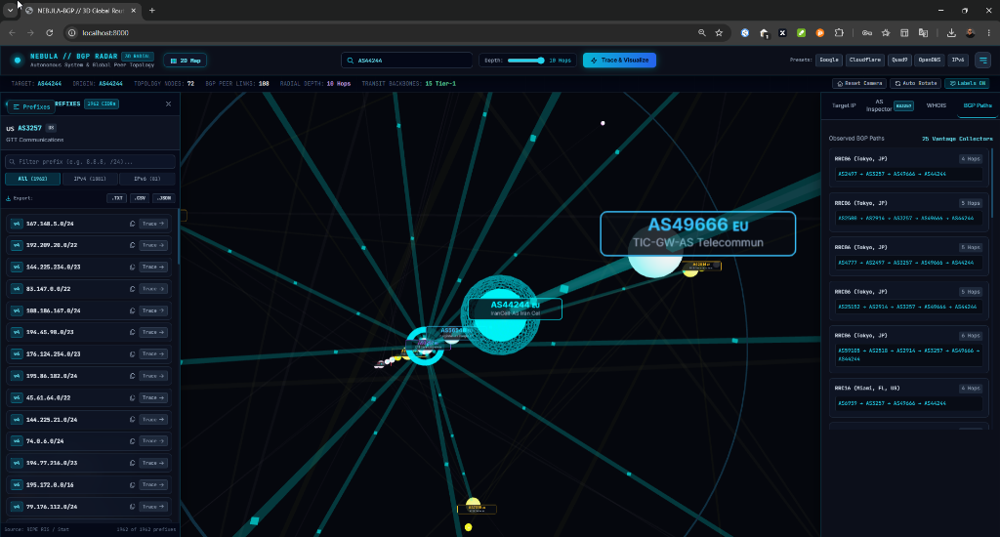

# 🛰️ رادار توپولوژی و مسیریابی جهانی Nebula BGP 3D MAP (NEBULA-BGP)

<div align="center" dir="rtl">

[](https://www.python.org/)
[](https://fastapi.tiangolo.com/)
[](https://threejs.org/)
[](https://stat.ripe.net/)
[](LICENSE)
[](https://github.com/mehdisec)

**سامانه پیشرفته و تعاملی تحلیل، رهگیری و تصویرسازی دوبعدی و سه‌بعدی توپولوژی مسیریابی سیستم‌های خودمختار (AS) و هوش تجاری شبکه.**

[English Documentation](README.md) • [راهنمای فارسی](README_FA.md)

<br/>

<p align="center">
  
</p>

</div>

---

## 📖 فهرست مطالب
- [معرفی پروژه](#-معرفی-پروژه)
- [ویژگی‌های کلیدی](#-ویژگیهای-کلیدی)
  - [۱. موتور توپولوژی سه‌بعدی مداری (3D Radial Sphere)](#۱-موتور-توپولوژی-سهبعدی-مداری-3d-radial-sphere)
  - [۲. نقشه دو بعدی ارتوگونال استاتیک (2D Planar Map)](#۲-نقشه-دو-بعدی-ارتوگونال-استاتیک-2d-planar-map)
  - [۳. سایدبار چپ: پیشوندهای اعلام‌شده و خروجی چندگانه (TXT / CSV / JSON)](#۳-سایدبار-چپ-پیشوندهای-اعلامشده-و-خروجی-چندگانه-txt--csv--json)
  - [۴. سایدبار راست: تحلیل جامع AS و روابط همتایی (Peering)](#۴-سایدبار-راست-تحلیل-جامع-as-و-روابط-همتایی-peering)
  - [۵. نشانگر هوشمند هولوگرافیک با شمارنده ۲ ثانیه‌ای (Hover HUD)](#۵-نشانگر-هوشمند-هولوگرافیک-با-شمارنده-۲-ثانیهای-hover-hud)
- [⚡ نصب و راه‌اندازی سریع (اسکریپت تک‌خطی)](#-نصب-و-راهاندازی-سریع-اسکریپت-تکخطی)
  - [ویندوز (PowerShell)](#ویندوز-powershell)
  - [لینوکس و مک (Bash)](#لینوکس-و-مک-bash)
  - [اجرا با یک کلیک (Windows Batch)](#اجرا-با-یک-کلیک-windows-batch)
  - [نصب به عنوان پکیج پایتون (pip)](#نصب-به-عنوان-پکیج-پایتون-pip)
- [📡 مستندات API (اندپوینت‌های وب‌سرویس)](#-مستندات-api-اندپوینتهای-وبسرویس)
- [🏗️ ساختار پروژه و فناوری‌های استفاده‌شده](#️-ساختار-پروژه-و-فناوریهای-استفادهشده)
- [👤 توسعه‌دهنده](#-توسعهدهنده)
- [📄 مجوز (License)](#-مجوز-license)

---

## 🔭 معرفی پروژه

پروژه **NEBULA-BGP** با دریافت هر نوع آدرس اینترنتی اعم از **IPv4، IPv6، رنج‌های شبکه CIDR (مانند `8.8.8.0/24`) یا شماره سیستم خودمختار (مانند `AS15169`)**، به صورت بلادرنگ به جمع‌آوری اطلاعات از بیش از ۲۳ ایستگاه بین‌المللی جمع‌آوری مسیر RIPE RIS در سراسر جهان پرداخته و گراف ارتباطات، مسیرهای BGP Looking Glass، اپ‌استریم‌ها و ستون‌های فقرات Tier-1 را تا عمق **۱۰ هاپ مداری** ترسیم می‌کند.

---

## ✨ ویژگی‌های کلیدی

### ۱. موتور توپولوژی سه‌بعدی مداری (3D Radial Sphere)
- **لایه‌های هم‌مرکز شعاعی (هاپ ۰ تا ۱۰):** نود مبدا در مرکز مختصات $(0, 0, 0)$ قرار گرفته و حلقه‌های مداری شفاف به دور آن تا دورترین نودهای حاشیه‌ای ادامه دارند.
- **تفکیک رنگی استاندارد سطوح شبکه:**
  - 🔵 **هاپ ۰ (هدف اصلی / مبدا):** فیروزه‌ای نئونی درخشان (`#00f0ff`)
  - 🔷 **هاپ ۱ (همسایگان مستقیم و ترانزیت‌ها):** آبی آسمانی (`#38bdf8`)
  - 🟣 **هاپ ۲ (ستون‌های فقرات جهانی Tier-1):** بنفش درخشان (`#a855f7`)
  - 🟡 **هاپ ۳ تا ۵ (ارائه‌دهندگان منطقه‌ای):** طلایی / کهربایی (`#fbbf24`)
  - 🔴 **هاپ ۶ تا ۱۰ (شبکه‌های حاشیه‌ای و لبه):** سرخابی / زرشکی (`#f43f5e`)
- **مش شبکه‌ای واقعی Tier-1:** بازسازی دقیق نشست‌های همتایی بدون‌هزینه (Settlement-Free Peering) میان غول‌های ترانزیت جهان نظیر Level 3، Telia/Arelion، NTT، Cogent، Hurricane Electric، Zayo و غیره.
- **شبیه‌سازی جریان بسته‌های داده:** عبور ذرات نوری بر روی پیوندها در حالت ۳ بعدی برای نمایش پویایی انتشار مسیرها.

### ۲. نقشه دو بعدی ارتوگونال استاتیک (2D Planar Map)
- **کلید جابجایی دو بعدی در هدر بالا سمت چپ:** سوئیچ با یک کلیک بین نمای `🗺️ 2D Map` و `🌐 3D View`.
- **چیدمان قطبی کاملاً بدون هم‌پوشانی:** توزیع ریاضی دقیق نودها روی محیط دوایر دو بعدی ($R = 140 \times \text{Hop}$) بدون هیچ‌گونه فشرده‌شدن یا افتادن نودها به مرکز صفحه.
- **معماری استاتیک مهندسی:** حذف کامل حرکت ذرات و چرخش انیمیشنی در حالت دو بعدی جهت ایجاد دیاگرام شفاف و پایدار.
- **لینک‌های بسیار واضح و پرکنتراست:** شفافیت ۹۳٪ خطوط و ضخامت تقویت‌شده (`1.8px` تا `4.2px`) روی پس‌زمینه تیره.
- **هایلایت درجا (بدون پرش نقشه):** کلیک روی هر AS، هاله نوری نئونی دور آن نود ایجاد کرده و تمام پیوندهای آن را پررنگ می‌کند، بدون اینکه مرکز کل نقشه جابجا شود.

### ۳. سایدبار چپ: پیشوندهای اعلام‌شده و خروجی چندگانه (TXT / CSV / JSON)
- **نمایش بلادرنگ رنج‌های اعلام‌شده (Announced Prefixes):** به محض کلیک روی هر نود، پیشوندهای IPv4 و IPv6 آن از RIPE RIS واکشی و در سایدبار سمت چپ لیست می‌شوند.
- **فیلتر آنی و تب‌های پروتکل:** جستجوی فوری در متن پیشوندها و تب‌های تفکیک‌شده برای `All`، `IPv4` و `IPv6`.
- **ردگیری با یک کلیک (Trace Prefix):** با فشردن کلید Trace در کنار هر پیشوند، توپولوژی شبکه فوراً برای آن رنج بازآفرینی می‌شود.
- **خروجی با متادیتای کامل AS:**
  - 📄 **`.TXT`:** گزارش جامع متنی شامل هدر مشخصات AS، نام سازمان، کشور، نقش شبکه و لیست شماره‌گذاری‌شده پیشوندها.
  - 📊 **`.CSV`:** جدول استاندارد و آماده استفاده در Excel شامل ASN، نام سازمان، کشور، نسخه IP، رنج CIDR و زمان خروجی.
  - 📦 **`.JSON`:** فایل داده ساختاریافته شامل مشخصات کامل رجیستری AS، آمارها و آرایه‌های دسته‌بندی‌شده.

### ۴. سایدبار راست: تحلیل جامع AS و روابط همتایی (Peering)
- **خلاصه هدف (Target Summary):** موقعیت جغرافیایی IP، شرکت ارائه‌دهنده، مختصات مکانی و پیشوند.
- **بازرس AS (AS Inspector):** رتبه‌بندی قدرت AS، تاریخ ثبت در رجیستری، مخاطبین Abuse و چیپ‌های تعاملی همسایگان متصل.
- **سوابق WHOIS و RDAP:** رنج شبکه، سازمان ثبت‌کننده، آدرس ثبتی و ایمیل‌های نظارتی.
- **مسیرهای Looking Glass:** مسیرهای کامل BGP جمع‌آوری‌شده از سرتاسر مراکز اندازه‌گیری جهان.

### ۵. نشانگر هوشمند هولوگرافیک با شمارنده ۲ ثانیه‌ای (Hover HUD)
- **شمارنده دایره‌ای ۲ ثانیه:** حلقه پیشرفت معکوس (`2.0s → 0s`) برای اطمینان از قصد کاربر و جلوگیری از باز شدن ناخواسته پاپ‌آپ‌ها.
- **کارت هولوگرافیک ثابت‌شده:** نمایش پرچم کشور، رده بین‌المللی شبکه، تعداد همسایگان و دکمه فوکوس با یک کلیک.

---

## ⚡ نصب و راه‌اندازی سریع (اسکریپت تک‌خطی)

### ویندوز (PowerShell)
پاورشل را در دایرکتوری پروژه باز کرده و دستور زیر را اجرا کنید:
```powershell
powershell -ExecutionPolicy Bypass -File .\install.ps1
```
*یا دستور تک‌خطی زیر:*
```powershell
python -m pip install -r requirements.txt; python run.py
```

### لینوکس و مک (Bash)
ترمینال را در پوشه پروژه باز کرده و دستور زیر را اجرا کنید:
```bash
chmod +x install.sh && ./install.sh
```
*یا دستور تک‌خطی زیر:*
```bash
python3 -m pip install -r requirements.txt && python3 run.py
```

### اجرا با یک کلیک در ویندوز (Batch)
کافیست روی فایل **`run.bat`** دابل‌کلیک کنید تا پیش‌نیازها بررسی و سرور اجرا شود.

### نصب به عنوان پکیج پایتون (pip)
پروژه را به صورت مستقیم در پایتون نصب و اجرا کنید:
```bash
pip install -e .
nebula-bgp
```

پس از راه‌اندازی سرور، مرورگر خود را به آدرس زیر هدایت کنید:
👉 **`http://localhost:8000`**

---

## 📡 مستندات API (اندپوینت‌های وب‌سرویس)

مستندات تعاملی Swagger به صورت پیش‌فرض در آدرس **`http://localhost:8000/docs`** در دسترس است:

| متد | آدرس اندپوینت | توضیحات |
|---|---|---|
| `GET` | `/api/trace?target={ip/cidr/asn}&depth={1-10}` | رهگیری مسیر BGP و تولید گراف توپولوژی ۲ بعدی و ۳ بعدی |
| `GET` | `/api/as/{asn}` | دریافت پروفایل کامل، مشخصات سازمانی، کشور و اطلاعات همتایی AS |
| `GET` | `/api/as/{asn}/prefixes` | دریافت تمام رنج‌های اعلام‌شده IPv4 و IPv6 مربوط به AS |
| `GET` | `/api/health` | بررسی سلامت سرویس و نسخه فعال موتور |

---

## 🏗️ ساختار پروژه و فناوری‌های استفاده‌شده

```
d:\1\BGP\
├── backend/
│   ├── main.py            # اندپوینت‌های FastAPI، واسط خط فرمان CLI و فایل‌های استاتیک
│   ├── bgp_service.py     # موتور رهگیری Looking Glass، اتصال به RIPE RIS و تولید گراف
│   ├── as_database.py     # پایگاه داده شبکه‌های اصلی و Tier-1 اینترنت جهانی
│   ├── models.py          # ساختار داده‌های Pydantic
│   └── cache.py           # سیستم کش حافظه‌ای با سرعت پاسخ‌دهی زیر ۵ میلی‌ثانیه
├── frontend/
│   ├── index.html         # داشبورد دارک مدرن با سایدبارهای چپ و راست
│   ├── css/style.css      # استایل‌های نئونی گلس‌مورفیسم و پایدارسازی نمایشگر
│   ├── js/
│   │   ├── app.js         # مدیریت رویدادها، جستجو، تب‌ها و منطق خروجی TXT/CSV/JSON
│   │   ├── visualizer3d.js# موتور گراف سه‌بعدی و دو بعدی ارتوگونال (Three.js + ForceGraph)
│   │   └── hover_hud.js   # شمارنده ۲ ثانیه‌ای هاور و کارت هولوگرافیک نودها
│   └── vendor/            # اسکریپت‌های Three.js و 3d-force-graph آفلاین
├── install.ps1            # اسکریپت تک‌خطی نصب و اجرا برای پاورشل ویندوز
├── install.sh             # اسکریپت تک‌خطی نصب و اجرا برای لینوکس و مک
├── run.bat                # لانچر یک‌کلیکه ویندوز
├── setup.py               # فایل پکیجینگ پایتون
├── requirements.txt       # کتابخانه‌های پایتون مورد نیاز
└── run.py                 # لانچر سریع پایتون
```

- **بک‌اند:** Python 3.9+, FastAPI, Uvicorn, HTTPX (Async), Pydantic v2
- **فرانت‌اند:** HTML5, Vanilla JavaScript (ES6+), Three.js (r128), 3d-force-graph, Tailwind CSS
- **منابع زنده داده:** RIPE NCC RIS, RIPE Stat APIs, PeeringDB, پایگاه‌های رجیستری RDAP

---

## 👤 توسعه‌دهنده
**mehdisec**
- گیت‌هاب: [@mehdisec](https://github.com/mehdisec)

---

## 📄 مجوز (License)
این پروژه متن‌باز بوده و تحت مجوز بین‌المللی [MIT License](LICENSE) منتشر شده است.
